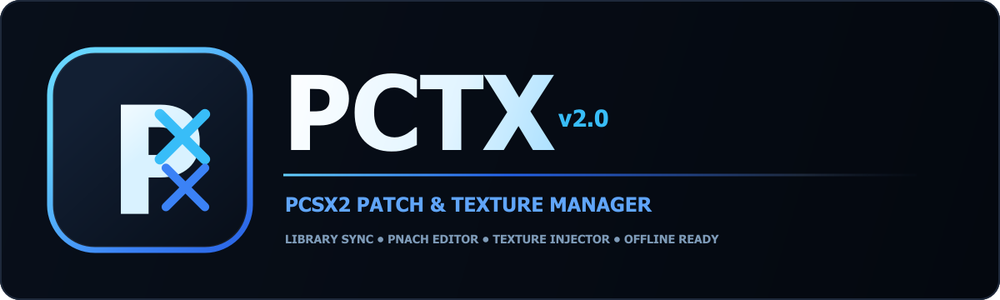
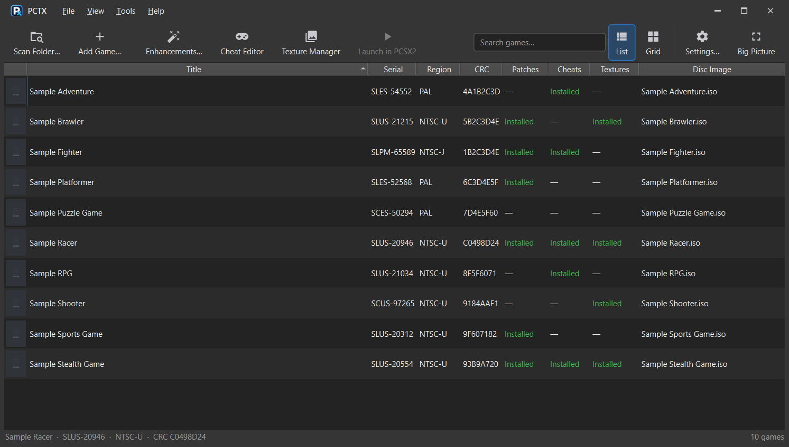
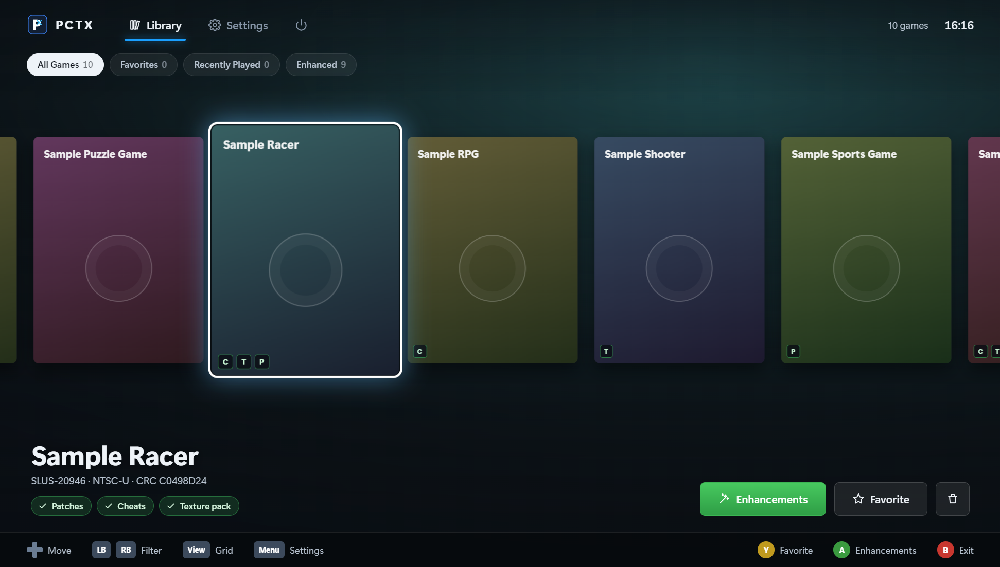
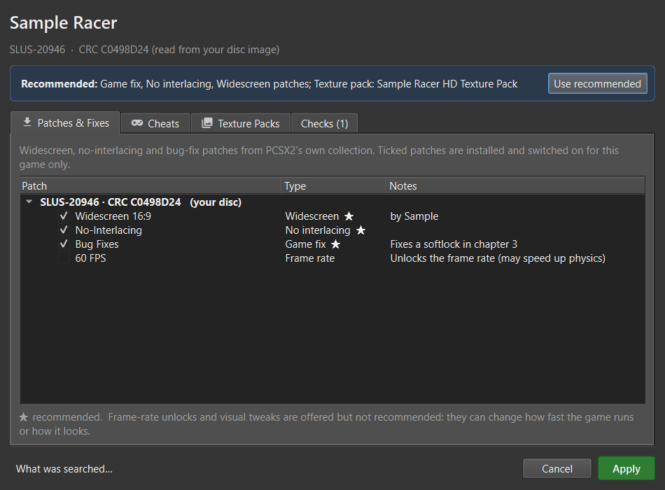

<p align="center">
  
</p>

# PCTX

Cheats, patches and texture packs for your PCSX2 game library.

Point PCTX at the folder where you keep your PS2 disc images, pick a game, and open its **Enhancements**: PCSX2's widescreen, no-interlacing and bug-fix patches, cheat codes, and HD texture packs, all in one place. PCTX reads each disc's exact CRC, installs the files where PCSX2 looks for them, **switches them on in PCSX2 for that game**, and shows what every game has at a glance. "Enhancements" never installs or changes the game itself.

PCTX is a Windows desktop app written in Python with PySide6. It does not include games, BIOS images or emulator code, and it is not affiliated with the PCSX2 project.



## Features

- **Game library.** Scan a folder for `.iso`, `.bin`, `.cso` and `.chd` images, or add a game by serial. For `.iso`, `.bin` and `.cso`, PCTX reads the serial and the **exact CRC** straight from the disc (the same way PCSX2 computes it), so cheats and patches always match your copy, not a database guess for another revision. Cover art is fetched and cached.
- **Enhancements, one screen per game.** Patches & fixes, cheats and texture packs side by side, each showing what's available, what's installed and what's switched on. Nothing changes until you press Apply, and anything installed can be removed again from the same screen.
- **Recommended.** One button picks the safe improvements for the game: widescreen, no-interlacing and bug-fix patches for your exact disc, plus the best texture pack when it's verified or a likely match. Frame-rate unlocks, visual tweaks and cheats are offered but never switched on for you. Tools > Apply Recommended Patches to All Games does the patch part for the whole library.
- **Actually switched on in PCSX2.** PCSX2 2.x ignores a named patch or cheat until it's enabled for that game. PCTX writes those switches into PCSX2's per-game settings (`gamesettings/<SERIAL>_<CRC>.ini`), and turns on PCSX2's global "Enable cheats" or "Load texture replacements" when you enable something that needs it.
- **Checks.** Each game's Enhancements list anything that would stop them from working (an unknown CRC, cheats or texture replacement turned off in PCSX2) with a one-click fix.
- **Patches & fixes** come from [PCSX2's own patch collection](https://github.com/PCSX2/pcsx2_patches), matched by serial and CRC, with every patch inside a file listed and labelled (widescreen, no-interlacing, game fix, frame rate, visual tweak).
- **Cheats** are merged from every source at once: the bundled database, community `.pnach` collections on GitHub, and GameHacking.org, with duplicates removed and codes for other revisions of the game left out.
- **Texture packs.** The hand-checked list first, then the [PS2 texture-pack catalog](https://ps2ktxpak.github.io/catalog/) (about 1,000 packs, matched by your disc's serial), then GitHub and the Internet Archive searched with several spellings of the title. Free packs on GitHub or the Internet Archive install automatically; free packs on Google Drive, Mega or MediaFire open in your browser; paid packs only ever link to the creator's own page. Every result is scored against the game, and videos, other games, other sequels and anything without a downloadable `.zip`/`.7z` are dropped, so what's left is labelled Verified, Likely match or Possible match. With texture dumping enabled in PCSX2, PCTX can also AI-upscale a game's own textures (Real-ESRGAN, downloaded on first use).
- **Launch.** Start a game in PCSX2 straight from the library.
- **Advanced editors.** Tools > Advanced Cheat Editor and Texture Manager for hand-editing `.pnach` files and staging packs yourself.
- **Settings that mirror PCSX2.** The option checkboxes read and write PCSX2's own `PCSX2.ini`, so they always show what PCSX2 will actually do.

## Two interfaces

Switch any time with **F11** (or View > Big Picture). PCTX remembers which one you used last.

**Classic** is a desktop layout in the spirit of PCSX2's own game list: menu bar, toolbar, a sortable table (or cover grid with a zoom slider) and a status bar.

**Big Picture** is fullscreen and built for a controller or a couch, in the spirit of Steam's Big Picture:




- A shelf or grid of covers over a soft, blurred backdrop of the selected game, with Library and Settings tabs and filters for All Games, Favorites, Recently Played and Enhanced.
- On-screen button hints follow whatever you used last: keyboard keys, mouse, or the real button labels of your controller (Xbox, PlayStation or Nintendo).
- Everything happens inside the fullscreen page, so no desktop window ever pops up over it: Settings, each game's Enhancements (with the same Recommended button and checks as Classic), adding or scanning games, recommended patches for the whole library, and a folder browser. Searches and installs run in the background, so the screen never freezes.
- Short interface sounds and animations, both of which you can turn down or off in Settings > Interface.

| | Keyboard | Controller |
|---|---|---|
| Move | Arrow keys | D-pad / left stick |
| Select | Enter | A (Xbox) / ✕ / B (Nintendo) |
| Back | Esc | B / ○ / A |
| Play in PCSX2 | P | X / □ / Y |
| Favorite | F | Y / △ / X |
| Previous / next filter | Q / E | LB / RB |
| Shelf / grid | G | View |
| Library / Settings | Tab | Menu |
| Cover size | + / - | Settings > Interface |
| Remove from library | Del | Remove button |

With a mouse: click to select, scroll to browse, right-click to go back, double-click a game to play it.

## Getting started

You need Windows, Python 3.10 or newer, and an existing PCSX2 install.

```powershell
git clone https://github.com/DahSidiAbdallah/PCTX.git
cd PCTX
python -m venv .venv
.\.venv\Scripts\Activate.ps1
pip install -r requirements.txt
python main.py
```

Run it from the project folder. To open it without a console window, use `pythonw main.py`, for example from a desktop shortcut whose "Start in" folder is the project folder. Edits to the source take effect the next time you start it; there is no build step.

### First run

1. **File > Settings.** Set PCSX2's data folder (the one that contains `cheats`, `patches`, `textures` and `inis`; **Detect** usually finds it). Set the PCSX2 program too if you want to launch games from here.
2. Turn on the options you want, such as cheats, widescreen patches and texture replacement. Close PCSX2 first; it rewrites its settings when it exits.
3. **File > Scan Folder** and choose your games folder.
4. Select a game and press **Enter** (or **Enhancements**). Press **Use recommended**, or tick exactly what you want on the Patches & Fixes, Cheats and Texture Packs tabs, then **Apply**.



## Where things come from

| What | Source |
|---|---|
| Cheats | Bundled database (`ps2_cheats_database_merged.json`), community `.pnach` collections on GitHub, GameHacking.org |
| Patches & fixes | `PCSX2/pcsx2_patches` on GitHub, indexed once and cached for a week |
| Texture packs | `texture_sources.json` (hand-checked), the [ps2ktxpak catalog](https://github.com/ps2ktxpak/catalog) (MIT, refreshed weekly), GitHub and Internet Archive searches, ranked and filtered |
| CRC | Read from your disc image (`.iso`, `.bin`, `.cso`); otherwise PCSX2's patch list or a database |
| Cover art, titles | Public cover databases and the bundled PSXDataCenter lists |

Search results that are not in the hand-checked list are labelled by how well they match and are never installed without your confirmation. Some community hosts (forums behind bot protection, Mega links) cannot be downloaded from automatically; a texture entry can still point at such a page and PCTX will open it in your browser instead.

## Your data

- Settings are stored under `HKEY_CURRENT_USER\Software\PCTX` in the Windows registry.
- The library list, cover thumbnails and the patch index are cached in your home folder under `.pcsx2_manager_*` names. The old prefix is kept on purpose so libraries from earlier versions keep working.
- Settings from before the rename to PCTX (stored under `PCSX2-Manager`) are copied across automatically the first time PCTX starts.
- Installing never deletes anything of yours: a patch file that already exists and differs is kept as `.bak`, a cheat file PCTX didn't write is only replaced if you say so, and removing a game from the library only edits PCTX's own list. Removing a texture pack from Enhancements deletes that game's `replacements` folder, after you've ticked "Remove".
- PCTX edits only the `[Patches]` / `[Cheats]` enable lists in PCSX2's per-game settings files and leaves every other setting in them alone.

## Project layout

| Path | Purpose |
|---|---|
| `main.py` | The application: window, library, dialogs, installers |
| `theme.py` | Colors and styling for both interfaces |
| `bigpicture.py`, `web/` | Big Picture: Qt wrapper, the page (`bigpicture.html`), input (`input.js`) and synthesized UI sounds (`sound.js`) |
| `patches_online.py` | Finds and installs PCSX2 patches (no Qt, unit-tested) |
| `texture_catalog.py` | Reads the PS2 texture-pack catalog and turns its entries into install / browser / paid-page options (no Qt, unit-tested) |
| `enhancements.py` | PCSX2's per-game enable lists, patch classification, recommendations, texture-pack matching, checks (no Qt, unit-tested) |
| `disc.py` | Reads a disc image's serial and exact CRC (`.iso`, `.bin`, `.cso`; unit-tested) |
| `cheat_online.py`, `textures_install.py`, `texture_upscale.py` | Cheat lookup, texture pack installation, AI upscaling |
| `texture_sources.json` | Curated texture pack list |
| `tools/build_icons.py` | Regenerates the app icon from its SVG sources |
| `tests/` | Test suite |

## Troubleshooting

- **Nothing installs.** Check File > Settings: the data folder must exist and show "PCSX2 found".
- **The options checkboxes are greyed out.** PCSX2 has not created `inis/PCSX2.ini` in that folder yet. Start PCSX2 once.
- **A game has no cover or title.** Add it with its serial (File > Add Game); the title is looked up from the bundled lists.
- **Online lookups fail.** Everything except downloading works offline; the bundled cheat database does not need a connection.
- **The taskbar shows the Python icon.** This happens with the Microsoft Store build of Python, which fixes the taskbar identity of anything it launches. A python.org install does not have the problem.

## Contributing

See [CONTRIBUTING.md](CONTRIBUTING.md).

## License

[MIT](LICENSE)
